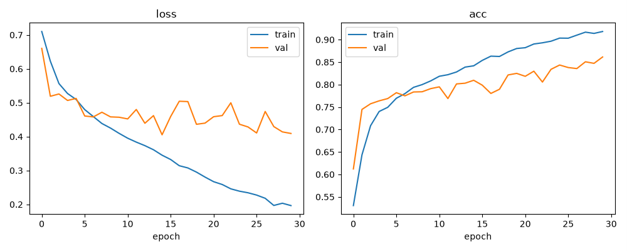
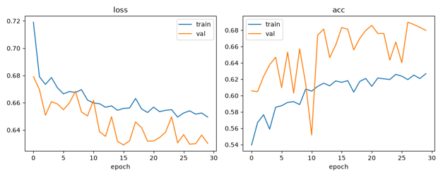

# COMP3710 Pattern Recognition and Analysis Final Project

## Project 2.1: Classification: Medical Diagnosis and Social Network Analysis

**Student Name:** Soong Earn Tang

**Student ID:** 50126558

**Model:** ConvNeXt

**Dataset:** ADNI

Alzheimer's disease (AD) is a progressive neurodegenerative disorder that affects memory and cognitive function. This project explores ConvNeXt for binary classification of 2D brain MRI slices from the Alzheimer's Disease Neuroimaging Initiative (ADNI) dataset, distinguishing Alzheimer's disease (AD) from normal controls (NC).

ConvNeXt modernizes convolutional neural networks using larger kernels, Layer Normalization, GELU activation, and inverted bottleneck blocks. In this project, the model is adapted for single-channel MRI images and two-class output, implemented in PyTorch, and trained from scratch.

<p align="center">
  
  <br>
  <em>ConvNeXt block</em>
</p>

## Table of Contents

1. [Feasibility Review](#1-feasibility-review-15102026)
2. [Purpose of each file](#2-purpose-of-each-file)
   - [dataset.py](#datasetpy)
   - [modules.py](#modulespy)
   - [train.py](#trainpy)
   - [predict.py](#predictpy)
   - [utils.py](#utilspy)
3. [Comparison between 2 models](#3-comparison-between-2-models-convnext-and-basic-mlp)
4. [Tuning model to reach 0.8 test accuracy](#4-tuning-model-to-reach-08-test-accuracy)
5. [Final Setup](#5-final-setup)
6. [Results](#6-results-best-run)
7. [Fault Analysis](#7-fault-analysis)
8. [Replication of Project](#8-replication-of-project)
9. [Artificial Intelligence Usage Disclosure](#9-artificial-intelligence-usage-disclosure)

---

## 1. Feasibility Review (15/10/2026)

### 1) User Need, Scope & Acceptance Criteria

**Intended User:** healthcare professionals like doctors, nurses, other medical staff and patients and their families.

**Prototype Purpose:** detect this disease at an early stage as it is irreversible. Once it is detected, it can be treated earlier.

**Acceptance Criteria:**

1. Minimum 0.8 test accuracy on AD vs CN.
2. It is better to have more false positives compared to false negatives. If there is a false positive, further testing can prove that the person is healthy. However, if there is a false negative, the person may be declared healthy and miss the best treatment time.
3. It must be a leakage-free evaluation.

**Peak VRAM Constraint:** personal GPU (NVIDIA GeForce RTX 4050 Laptop) = 6GB

### 2) Model Choice & Course Concepts

**Model Choice:** ConvNeXt

**Dataset Configuration:** ADNI dataset (split into test and train dataset accordingly and each with AD and NC data inside)

**Model Architecture:**

<p align="center">
  
  <br>
  <em>General structure</em>
</p>

Unlike most modern models which use transformers, ConvNeXt uses pure convolution. However, it is modernized by changing several things such as big kernel size, layer normalization, GELU and others.

**Difficulty Band:** Hard

**How course concepts and literature support the choices:**

- CNN was introduced at very early stages in this course.
- ConvNeXt was shown to outperform certain transformers such as Swin Transformers by modernizing normal convolutions. (*A ConvNet for the 2020s*, Liu et al., 2022)

### 3) Preliminary Feasibility Evidence

- 20 epochs: 1 hour
- Test accuracy: 0.71 (way lower than required 0.8)

<p align="center">
  
  <br>
  <em>Feasibility result</em>
</p>

**Resource estimate:** 2 hours per train (increase in epoch and other changes)

### 4) Risks, Budget & Fallback

- **Key technical risks:** data leakage between train and test, overfitting, training instability
- **Computing budget:** peak VRAM 6GB
- **Next planned experiment:** increasing number of epochs is not very reasonable, so other factors need tuning such as hyperparameters, data preprocessing, data augmentations

---

## 2. Purpose of each file

### dataset.py

Handles dataset loading, preprocessing, augmentation, and PyTorch DataLoader creation for ConvNeXt-Tiny.

**Given dataset breakdown**

```text
ADNI dataset (30,520 files)
├── test (9,000 files)
│   ├── NC (4,540 files)
│   └── AD (4,460 files)
└── train (21,520 files)
    ├── NC (11,120 files)
    └── AD (10,400 files)

Total NC = 15,660 files
Total AD = 14,860 files
```

The ADNI dataset contains 30,520 MRI images, comprising 15,660 NC and 14,860 AD images. With a relatively balanced class distribution, the dataset can be used directly for binary classification without additional class-balancing techniques.

The original training set contains 21,520 images (70.51%). Of the 9,000 images in the original test set, 30% are allocated to validation, resulting in 2,700 validation images (8.85%) and 6,300 test images (20.64%).

```text
30520 files
Train      : 21520 (70.51%)
Validation :  2700 (8.85%)
Test       :  6300 (20.64%)
```

**Reason for the split:** The dataset follows an approximately 70/10/20 training, validation, and test split. Since the original dataset already provides 70.51% for training and 29.49% for testing, 30% of the original test set is allocated to validation, resulting in 70.51% training, 8.85% validation, and 20.64% testing.

**Preprocessing and augmentation (train)**

- Convert images to grayscale.
- Crop black borders and resize to 224 × 224 pixels.
- Normalize pixel values.
- Apply random affine transformations and brightness/contrast adjustments during training to reduce overfitting.
- Load images in batches using PyTorch DataLoader, with GPU transfer handled during training.

Validation and test images use consistent preprocessing without augmentation.

### modules.py

Builds the structure of the model.

**Model Architecture**

ConvNeXt is a pure convolutional neural network (ConvNet) that modernizes the traditional ResNet architecture by incorporating design choices inspired by Vision Transformers (ViTs). Its key insight is that a conventional CNN can achieve competitive accuracy, scalability, and efficiency without using self-attention.

<p align="center">
  
  <br>
  <em>A modernized CNN</em>
</p>

| | Normal CNN | ConvNeXt |
|---|---|---|
| Kernel Size | 3 x 3 (typical) | 7 x 7 depthwise |
| Activation Function | ReLU | GELU |
| Normalization | Batch Normalization | Layer Normalization |
| Stem | 7 x 7 stride-2 conv + max pool | 4 x 4 stride-4 "patchify" conv, no max pool |
| Block design | Bottleneck (wide, narrow, wide) | Inverted bottleneck (narrow, wide, narrow) |
| Activations / norms per block | After every conv | One GELU and one LayerNorm per block |
| Down sampling | Stride convolutions inside blocks | Separate 2 x 2 stride-2 conv between stages |

**The model for the ADNI dataset**

- ConvNeXt-tiny implemented from scratch in PyTorch
- Binary classification of single-channel ADNI brain slices

**ConvNeXt block.** Each block applies a 7x7 depthwise convolution, then LayerNorm, then an inverted-bottleneck MLP (Linear expanding the channels 4x, GELU, Linear projecting back down). The output is scaled by a learnable layer-scale parameter (initialised to 1e-6), passed through stochastic depth during training, and added to the block's input through a residual connection.

**Regularisation.** Stochastic depth (drop path) randomly skips the residual branch of a block during training. The drop rate increases linearly across the 18 blocks, up to a maximum of 0.3.

### train.py

The training configuration defines the epochs, learning rate, and random seed. The model is defined and saved, with training managed by `run_epoch`. Data loaders and model components are imported from `dataset.py` and `modules.py`.

Cross-Entropy Loss with label smoothing, AdamW, and a learning rate scheduler are used. Each epoch records training and validation loss and accuracy, saving the best-performing model checkpoint.

Finally, the loss and accuracy curves are plotted, and evaluation results are printed, including the classification report, confusion matrix, and NC (Normal Control) and AD (Alzheimer's Disease) performance breakdown.

### predict.py

The trained model is loaded and evaluated on the test set. The confusion matrix is saved, and correct and incorrect predictions are displayed.

The Grad-CAM function highlights the image regions that influence the model's prediction. The model then generates predictions and visualizes the areas contributing to each classification.

### utils.py

Checks for overlapping: whether there is leakage of patients between train, validation and test.

---

## 3. Comparison between 2 models (ConvNeXt and Basic MLP)

**Chosen baseline model: Basic MLP**

All other variables are kept constant to ensure a fair comparison, with model architecture being the only variable that changes.

**Controlled variables**

1. Seed = 0
2. Epoch = 30
3. Batch size = 32
4. Optimizer = Adam
5. Parameters = 27.82M
6. Learning rate = 1e-4
7. Loss function = Cross Entropy Loss
8. Train/val/test split (20% of train patients for validation)
9. Preprocessing and augmentations (imported from `dataset.py` to ensure that it is the same)
10. Evaluation metrics (loss, accuracy, AUROC, classification report, confusion matrix, peak VRAM)
11. Model selection = the checkpoint with the highest validation accuracy was selected, and that checkpoint was evaluated on the test set.

**Trial and errors**

1. Chose ResNet-50 as baseline as it can be modified from demo 2 ResNet-18 because it has the same structure.
2. Result: ResNet has a higher test accuracy compared to ConvNeXt.
3. Confusion: Unclear if all parameters need to be the same including normalization technique, activation function and others.
4. Realization: ResNet-50 shouldn't be used as a baseline comparison as the question only asks for a standard convolutional network, MLP, or basic linear classifier.
5. A basic MLP is then chosen as the comparison.
6. The parameters are set to be the same for comparison as shown above.

**ConvNeXt training curves**

<p align="center">
  
  <br>
  <em>Baseline ConvNeXt</em>
</p>

**MLP training curves**

<p align="center">
  
  <br>
  <em>Baseline MLP</em>
</p>

**Results**

| | ConvNeXt | Basic MLP |
|---|---|---|
| Best validation accuracy | 0.8609 | 0.6898 |
| Test accuracy | 0.7366 | 0.6207 |
| Test AUROC | 0.8176 | 0.6384 |
| Peak VRAM | 2.68 GB | 0.58 GB |

The results show that ConvNeXt outperformed the Basic MLP in validation accuracy, test accuracy, and test AUROC. Test accuracy is respectively 62.07% and 73.66%, representing a difference of 11.59 percentage points. Test AUROC increased from 0.6384 to 0.8176, indicating that ConvNeXt had a stronger ability to distinguish between the NC and AD classes across different classification thresholds. Besides, from the training curves, we can observe that the loss and accuracy of ConvNeXt perform much better compared to MLP. It has lower losses and higher accuracies.

ConvNeXt also required more peak GPU memory, using 2.68 GB compared with 0.58 GB for the Basic MLP. This indicates a higher memory requirement under the tested configurations, despite both models having approximately the same number of parameters.

Overall, ConvNeXt achieved stronger classification performance than the Basic MLP on the reported accuracy and AUROC metrics, at the cost of higher GPU memory usage. These results suggest that ConvNeXt is better suited to this image-classification task under the experimental conditions used.

---

## 4. Tuning model to reach 0.8 test accuracy

### Initial setup

20% from train used as validation

```text
Train      : 17216 (56.41%)
Validation :  4304 (14.1%)
```

| Changes | Test Accuracy |
|---|---|
| Adam to AdamW (Adam used for baseline comparison) | 0.7524 |
| Drop_path = 0.1 | 0.7276 |
| Average each patient's slices | 0.7600 per patient |
| Filter for keep patient slices 78 to 107 | 0.7314 |
| Crop to the brain region | 0.7339 |
| Strong augmentation (flip, larger affine and jitter) | 0.7156 |
| Label smoothing = 0.1 | 0.7371 |
| Lr 2e-4 | 0.7491 |
| Lr 2e-4 | 0.7594 (0.7889 per patient) |
| Lr 8e-4 | 0.7506 |
| 50 epochs (lr 4e-4) | 0.7590 |
| Seed = 2 | 0.7599 |
| TTA | 0.7644 |
| Ensemble of 5 models | 0.7800 per patient |
| Remove filter | 0.7594 |

### 20/10/2026: validation split from the test set

Tutor (Jevi) told me to split the validation set from the test set instead of the train set, and to perform the test after each epoch.

**Setup**

10% from test used as validation.

Reason:

- The test set is too big (~30% of the total dataset).
- Normally, splitting is done by taking the whole test set and performing 80% train, 20% test, 10% validation.
- Test with a smaller validation size first.

```text
train / val / test: 21520 / 900 / 8100
```

| Changes | Test Accuracy |
|---|---|
| Drop_path = 0.1 | 0.7276 |
| Average each patient's slices | 0.7600 per patient |
| Filter for keep patient slices 78 to 107 | 0.7314 |
| Crop to the brain region | 0.7339 |
| Strong augmentation (flip, larger affine and jitter) | 0.7156 |
| Label smoothing = 0.1 | 0.7371 |
| Lr 2e-4 | 0.7491 |
| Lr 2e-4 | 0.7594 (0.7889 per patient) |
| **AdamW lr 6e-4, 10% validation from test** | **0.7878** |
| 30% validation from test | 0.7689 |
| 20% validation from test | 0.7760 |
| Turn on filter | 0.7502 |
| Deeper net, depths [3, 3, 12, 3] | 0.7796 |
| Smaller net, depths [2, 2, 6, 2] | 0.7779 |
| Lr 3e-4 | 0.7765 |
| Lr 8e-4 | 0.7506 |
| 50 epochs (lr 4e-4) | 0.7590 |
| Seed = 2 | 0.7599 |
| TTA | 0.7644 |
| Ensemble of 5 models | 0.7800 per patient |
| Remove filter | 0.7594 |

### 21/10/2026: learning rate and epochs

Tutor (Zhao) told me to increase the learning rate to 4e-3 (default ConvNeXt-tiny) and increase epochs to 100.

**Setup:** Lr = 4e-3

| Changes | Test Accuracy |
|---|---|
| Lr = 0.004 + 40 epochs | 0.7889 |
| **Lr = 0.004 + 100 epochs + best test accuracy** | **0.8089** |
| Remove validation set | 0.7971 |
| Lr = 0.01 | Crash (nan) |
| Lr = 0.008 | 0.7792 |
| Lr = 0.0008 (with validation from test) | 0.7481 (crash after 38 epochs) |

---

## 5. Final Setup

**Dataset:** ADNI dataset

**Hyperparameters**

| Parameter | Value |
|---|---|
| Seed | 0 |
| Epochs | 100 |
| Batch size | 32 |
| Optimizer | AdamW |
| Weight decay | 0.05 |
| Loss function | Cross Entropy Loss (label smoothing = 0.1) |
| Learning rate | 4e-3 (typical ConvNeXt-tiny learning rate) |

**Example of output**

```text
27.82M params | train/val/test: 21520 2700 6300 | lr 0.004 | seed 0
epoch   |  train       |  val         |  test        | best
        |  loss  acc   |  loss  acc   |  loss  acc   | test acc
1/100   |  0.7078 0.5770 | 0.6573 0.6152 | 0.6302 0.6768 | 0.6768
2/100   |  0.6145 0.6898 | 0.6141 0.7007 | 0.6351 0.6737 | 0.6768
...
75/100  |  0.2331 0.9800 | 0.7038 0.7874 | 0.6416 0.8122 | 0.8122
```

---

## 6. Results (Best Run)

The final results are trained on Rangpur.

<p align="center">
  
  <br>
  <em>Final results</em>
</p>

<p align="center">
  
  <br>
  <em>Final curves</em>
</p>

**Loss**

The training loss falls steadily from ~0.71 to ~0.20.

Validation and test loss reach their lowest around 20 epochs and rise to ~0.7 by epoch 100. The model gets confident on training data while getting worse at generalizing.

Validation and test are noisy with spikes, which fits the high learning rate with small batch size.

**Accuracy**

The training accuracy increases steadily to 0.99.

Validation and test accuracy reach their peak at around 0.8 around epoch 50.

**Others**

Peak VRAM: 2.68GB

Validation and test track each other closely, which shows that the split is consistent.

The curve shows overfitting with high learning rate and small batch size. The model learns the training data perfectly but performs worse at generalizing to new data.

**Limitations**

Although regularisation, a lower learning rate, stronger augmentation and early stopping would likely reduce the train-test gap and make training more stable, they are unlikely to raise test accuracy substantially above about 0.80. The model already fits the training data almost perfectly (99.8% accuracy), so the remaining error stems from generalisation to unseen patients rather than from optimisation.

The remaining errors likely come from the data rather than the training settings. Brains differ a lot between patients, not every slice of an AD patient shows visible signs of the disease, and there are relatively few distinct patients.

I tried hyperparameter changes intended to reduce this overfitting, such as a lower learning rate and stronger regularisation. These did narrow the train-test gap, but none of them reached the test accuracy of 0.8 achieved by the final configuration. Despite its overfitting, the final configuration therefore gave the best test accuracy, so it was kept.

| Metric | Value | Meaning |
|---|---|---|
| Best test accuracy (= test accuracy) | 0.8122 | About 81.2% of the 6,300 test samples were classified correctly. |
| Test loss | 0.6416 | Average cross-entropy loss on the test set (lower is better). |
| Test AUROC | 0.8766 | The probability that the model scores a random AD sample higher than a random NC sample. 0.5 is chance and 1.0 is perfect. |

### Confusion Matrix

<p align="center">
  
  <br>
  <em>Confusion matrix</em>
</p>

| | Predicted NC | Predicted AD | Total |
|---|---|---|---|
| **True NC** | 2819 | 221 | 3040 |
| **True AD** | 962 | 2298 | 3260 |

The confusion matrix shows that 962 true AD cases are predicted as NC (false negatives), so around 1,000 people who have Alzheimer's disease are told they are healthy.

At the same time, only 221 true NC cases are predicted as AD (false positives), so around 221 healthy people are told they have the disease.

This is not a good thing: there are far more false negatives than false positives, showing that the model is biased towards NC. Although the test accuracy successfully reaches 0.8, it still presents more false negatives than false positives.

### Other metrics

**NC**

- Precision 0.7456: of everything predicted NC, 75% is really NC.
- Recall 0.9273: of all true NC samples, 93% were found.
- F1 0.8266: the harmonic mean of precision and recall.

**AD**

- Precision 0.9123: of everything predicted AD, 91% is really AD.
- Recall 0.7049: of all true AD samples, only 70% were found.
- F1 0.7953: pulled down by the weak recall.

**Averages**

- Macro avg is the plain mean of the two classes' scores (precision 0.8289, recall 0.8161, F1 0.8109).
- Weighted avg weights each class by its support. Because the classes are nearly balanced (3040 NC vs 3260 AD), it sits close to macro. The results are very similar to macro avg.

Although this model reaches a test accuracy of 0.8122, it is biased towards NC. It gives few false alarms (221) but many missed AD cases (962).

When the model predicts AD, it is very likely to be right (91% precision, only 9% are actually NC).

However, when the model predicts NC, there is a much higher chance that it is AD (962 of 3781 NC predictions, about 25%).

**AUROC**

0.8766 (about 88% of the time, an AD patient would receive a higher risk score than an NC patient).

- Best case: 1.0 (every AD patient's score is higher than every NC patient's).
- 0.5 = chance level.
- Decision rule: predicted P(AD) ≥ 0.5 → AD; P(AD) < 0.5 → NC.

**Overlapping**

```text
train&test: 0   val&test: 0   train&val: 0
```

Patient IDs were extracted from filenames and compared across splits. No patient appears in more than one of the train, validation and test sets (0 shared patients for each pair), so there is no patient-level leakage.

---

## 7. Fault Analysis

<p align="center">
  
  <br>
  <em>Sample images</em>
</p>

The left four images are correct predictions and the right four are errors. The heatmaps highlight the regions that most influenced the prediction (brighter means more influence).

For the model to predict AD, the score needs to be near 1. For the model to predict NC, the score needs to be near 0. The closer the score is to 0 or 1, the more confident the model is in predicting the class.

Among the correct predictions, the first, third and fourth pictures show that the model has strong confidence (0.05 for NC, 0.95 for AD), and the second picture shows slightly lesser confidence (0.13 for NC).

Among the wrong predictions, the fifth, sixth and eighth pictures show that the model has strong confidence (0.05 for NC, 0.95 for AD), and the seventh picture shows that it has less confidence in predicting the wrong class (0.88 for AD).

Although the model is confident, it doesn't mean that it is correct.

Most images show that the heatmap is concentrated around the central brain region. However, pictures two and seven show that it is concentrated outside the brain, suggesting that the model may sometimes rely on background or cropping artefacts.

The heatmap purely indicates where the model is looking when making predictions, but it doesn't mean that it is correct to look at those regions to perform the predictions.

### Calibrated operating threshold and decision rule

1. **Calibrate with temperature scaling**: pulls the model number to a less confident number.
2. **Decide per patient instead of per slice**: average the scores of all patient slices.
3. **Use three zones instead of one cutoff**: if the score is within the middle zone, send it to an expert instead.
4. **Flag artefact cases**: report results to an expert if the model focuses outside of brain regions, regardless of the results.

---

## 8. Replication of Project

**Dataset:** ADNI

- Structured into train and test with NC and AD without bias
- File name: `<patientID>_<slice>.jpeg`

### Setup

1. Create and activate a virtual environment:

   ```bash
   python -m venv venv
   venv\Scripts\activate
   ```

2. Install the CUDA 13.0 build of PyTorch (needs an NVIDIA GPU).

3. Install the remaining packages from `requirements.txt`:

   ```bash
   pip install -r requirements.txt
   ```

### Hardware and software requirements

- NVIDIA GPU with CUDA support
- Sufficient disk space for storage
- GPU of 6GB to 8GB

---

## 9. Artificial Intelligence Usage Disclosure

**AI tool used:** Claude (Anthropic)

**1) Coding**

- Claude adapted the open source ConvNeXt implementation from GitHub (Liu et al., 2022) to fit this project.
- Claude also assisted in writing all the other code.
- Claude helped with errors and suggested changes to attempt.
- Claude converted the README file from Word to `.md` file format.

**Author responsibility**

- I ran all the evaluation and training myself and reported the outputs from experiments.
- I reviewed AI-assisted code and text before including it.